# Girl Period 🌸

[](https://github.com/pocketsunh-prog/girl-period/raw/main/download/girl-period-v1.0.apk)
[](#)
[](#)
[](#)

A Studio Ghibli-inspired period tracker for Android. Record your cycle, read the Chinese lunar
calendar, see live Hong Kong weather, keep events, and understand your body with simple charts —
all wrapped in a soft pastel cube-girl UI that you can recolour.

Everything is stored in a local SQLite database on your phone. No account server, no cloud, no ads.

---

## ⬇️ Download

| | |
|---|---|
| **Latest version** | v1.0 (`versionCode 1`) |
| **File** | [`girl-period-v1.0.apk`](https://github.com/pocketsunh-prog/girl-period/raw/main/download/girl-period-v1.0.apk) · 5.5 MB |
| **Requirements** | Android 7.0 (API 24) or newer · ~15 MB free space |
| **Signature** | Signed with the project release key (always install updates over the old app) |

**Direct link:** <https://github.com/pocketsunh-prog/girl-period/raw/main/download/girl-period-v1.0.apk>

### Install in 3 steps

1. **Download** the APK on your Android phone (tap the badge above or the direct link).
2. Open the downloaded file. If Android asks, allow **"Install unknown apps"** for your browser or
   file manager (Settings → Apps → Special access → Install unknown apps).
3. Tap **Install**, then open **Girl Period** and create your account.

> On first launch the app asks for notification, location and biometric permissions. Notification
> permission is needed for period/event reminders; location is used only to label the weather card
> and can be declined (your last saved city is still shown).

---

## 📱 Screenshots

| Calendar | Day details | Add period |
|:---:|:---:|:---:|
| 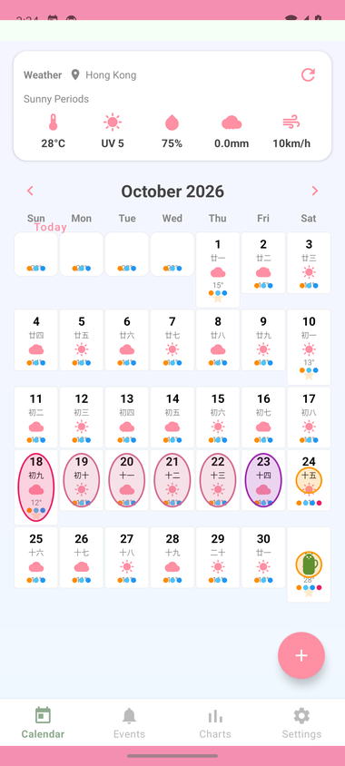 | 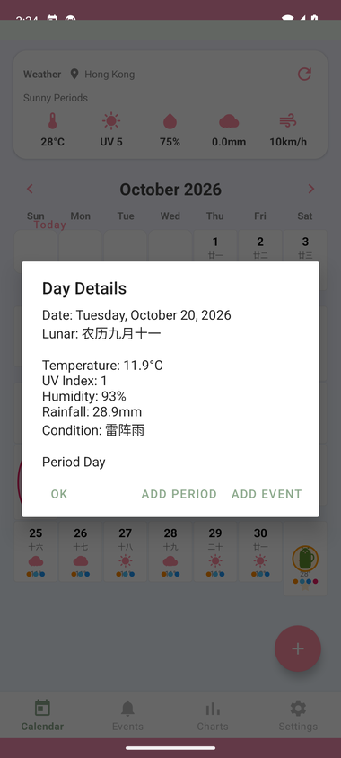 | 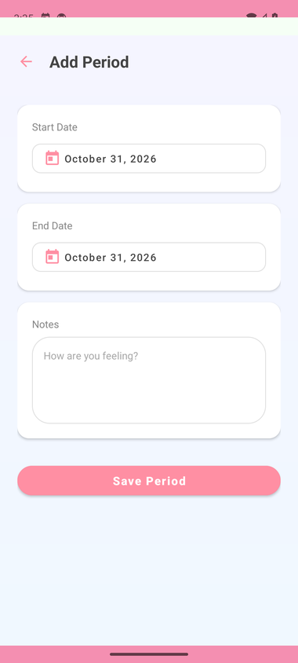 |
| Lunar + weather + period + events | Lunar, weather, festival and period info | Start/end dates with the Ghibli picker |

| Ghibli date picker | Events | Event editor |
|:---:|:---:|:---:|
| 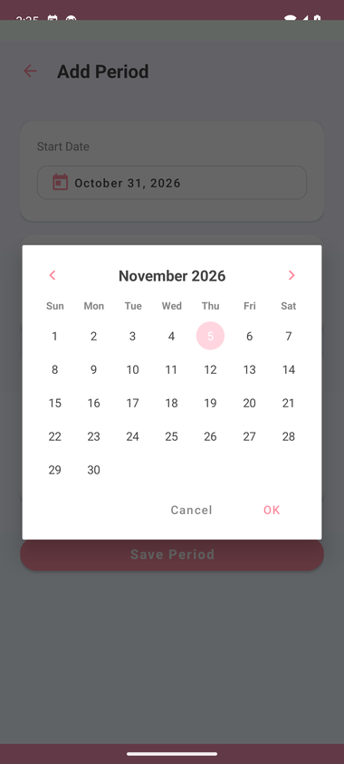 |  | 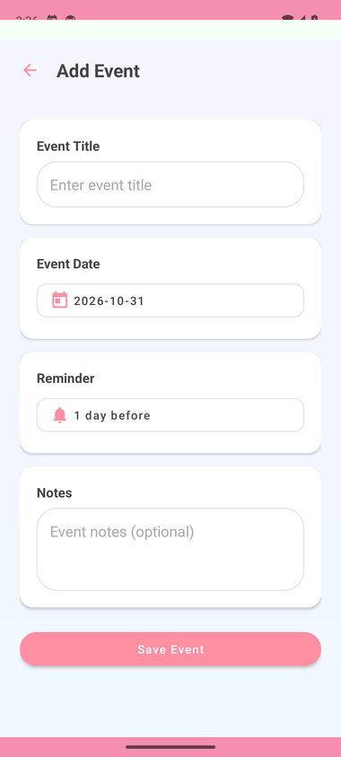 |
| Customizable fonts, colours, borders | Add / edit / delete, with reminders | Title, date, reminder days, notes |

| Charts | Cycle phases | Settings |
|:---:|:---:|:---:|
| 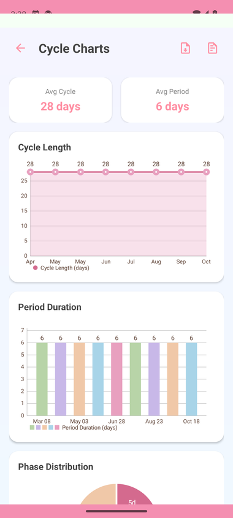 | 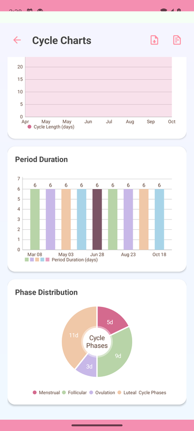 | 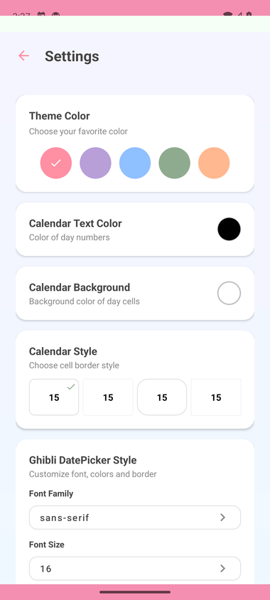 |
| Cycle length, duration, averages | Menstrual / follicular / ovulation / luteal | 5 themes, calendar styles, DatePicker style |

| Login | Register | Profile |
|:---:|:---:|:---:|
| 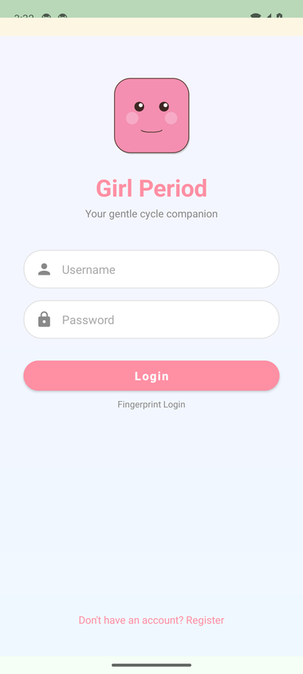 | 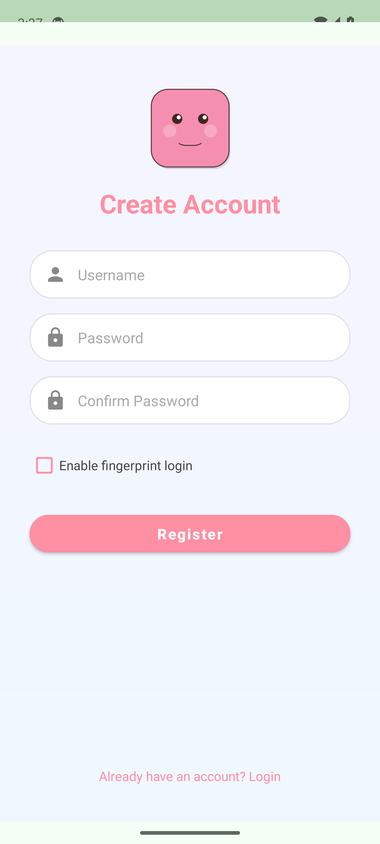 | 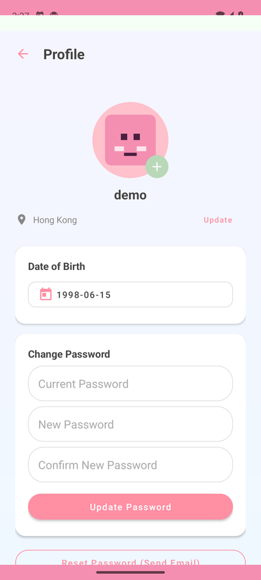 |
| Password or fingerprint | Username + password + fingerprint | Photo, DOB, password, location |

| Reminder popup | Home-screen widget |
|:---:|:---:|
| 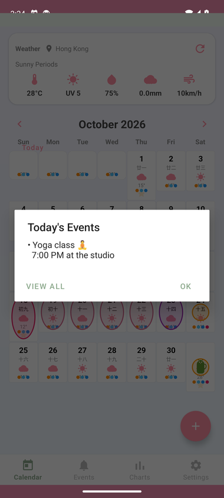 | 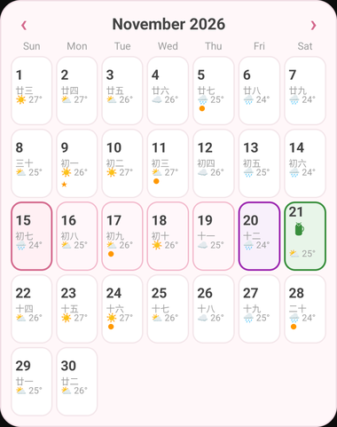 |
| Events and the 2-day period notice appear when you open the app | Calendar-style widget with lunar dates, weather, period days and today's pointer |

---

## ✨ Features

### Cycle tracking
- Month calendar with **period day highlighting** (start/end days styled distinctly)
- **Chinese lunar calendar** on every day, plus traditional festivals with a star icon
- **Prediction** of the next period, fertile window and ovulation from your history
- **Day details** dialog: date, lunar date, weather, festival, events, and period actions
- Year jump (100 years) and a **Today** button

### Ghibli UI
- **5 color themes**: Sakura, Matcha, Sky, Lavender, Peach
- **4 calendar cell styles**: Default, Compact, Rounded, Minimal
- Configurable calendar text colour and cell background colour
- Custom **Ghibli DatePicker**: choose font family, font size, font / border / selected-day colours
- Hand-drawn cube girl mascot and long-cat "today" icon

### Home-screen widget
- **Light month calendar widget** that matches the app's calendar look: white day cards, pink
  accents, the lunar date and the day's weather under every number
- **Period days are outlined** — pink for the first day, light pink for the days between, purple
  for the last day — plus an orange dot for events and a star for festivals
- **Today gets a green card and the long-cat pointer**, recomputed on every refresh so the pointer
  moves by itself at midnight (daily alarm + system date-change broadcast, re-armed after reboot)
- **‹ › arrows browse months**; tap the month title to jump back to today; tap any day to add a
  period for that date
- Weather icons/temperatures come from the app's last HKO update, so the widget works offline

### Live weather (Hong Kong Observatory)
- Real-time **temperature, UV index, humidity, rainfall and wind** from the
  [HKO Open Data API](https://www.hko.gov.hk/en/abouthko/opendata_intro.htm)
- Up to **9-day forecast** shown on the calendar cells, matching each date
- Refresh button, location label from your saved city, graceful offline fallback

### Events & reminders
- Add / edit / delete events with a title, date, notes and reminder lead time
  (1 day, 2 days, 3 days or 1 week before)
- Events highlighted on the calendar, with a dedicated event list page
- A **background foreground-service** re-checks hourly and repeats the reminder
  (a 3-day reminder notifies on each of the 3 days)
- Today's events popup when you open the app

### Period reminders
- **2 days before** the predicted period, the app notifies you, then again at 1 day
  and on the expected day — with a high-priority, vibrating notification on the day
- In-app popup (once per day) with an **Add Period** shortcut
- Daily 08:00 check re-armed automatically after reboot

### Analysis & export
- **Line chart**: cycle length over time
- **Bar chart**: period duration over time
- **Donut chart**: menstrual / follicular / ovulation / luteal phase split
- Average / shortest / longest cycle and average period length
- Export the analysis as **PDF** or **Excel (CSV)**, to a folder you pick in Settings

### Account & profile
- Local username/password accounts in **SQLite**
- **Fingerprint login** via AndroidX Biometric
- Profile photo from the gallery, date of birth (birthday events are created automatically),
  change / reset password, update saved location

---

## 🚀 How to use

### 1. Create an account
Open the app → **Register** → choose a username and password (tick *Enable fingerprint login* if you
want biometric sign-in) → **Register**. Accounts live only on your phone.

### 2. Log in
Enter your credentials → **Login**. If fingerprint login is enabled for that account, a
**Fingerprint Login** button appears under the password field.

### 3. Record your period
Tap the pink **+** button → pick the **Start Date** and **End Date** in the Ghibli date picker →
optionally add notes → **Save Period**. Add past cycles the same way — after two or more records the
app starts predicting your next period.

### 4. Read the calendar
- The current month opens by default; **‹ ›** change months and tapping the title jumps years.
- **Today** returns to the current date.
- Pink-outlined cells are recorded period days; the dashed prediction is your upcoming period.
- Each cell shows the lunar date, festival icon, weather icon and temperature.
- Tap any day for **Day Details**: lunar date, weather, festival, events and quick actions.

### 5. Check the weather
The card at the top shows live HKO data for Hong Kong (temperature, UV, humidity, rainfall, wind).
Tap the **refresh** icon to update; the location label comes from the last city saved in your profile.

### 6. Plan events
Bottom bar → **Events** → **Add** → title, date, reminder lead time and notes → **Save Event**.
Events appear in the list, are highlighted on the calendar, and trigger repeat reminders.

### 7. Analyse your cycle
Bottom bar → **Charts**: averages, cycle-length line, duration bars and phase distribution.
Use the **PDF** / **Excel** icons to export, then pick an export folder in Settings.

### 8. Make it yours
Bottom bar → **Settings**: pick one of the 5 themes, calendar text/background colours, a calendar
cell style, and customise the Ghibli DatePicker (font family, size, font/border/selected colours).
Notifications and fingerprint login toggles live here too.

### 9. Get your reminders
Keep the **Notifications** switch on. Two days before your predicted period you get a gentle
reminder, then again the day before and on the day. Event reminders follow the lead time you chose.

### 10. Add the home-screen widget
Long-press an empty spot on your home screen → **Widgets** → **Girl Period** → drag the calendar
widget onto the launcher. It follows your real data: the current month with lunar dates and
weather, pink/purple outlines on period days, an orange dot on event days, a star on festivals,
and a green card with the long-cat pointer on today. Use **‹ ›** to browse months, tap the month
title to return to today, and tap any day to add a period for that date.

---

## 🛠 Build from source

Requirements: **JDK 17**, Android SDK with **compileSdk 34**, Gradle 8.2 (or use the wrapper).

```bash
git clone https://github.com/pocketsunh-prog/girl-period.git
cd girl-period

# Debug build
./gradlew assembleDebug

# Signed release build (uses girlperiod-release-key.jks)
./gradlew assembleRelease
```

Output:

| Build | APK |
|---|---|
| Debug | `app/build/outputs/apk/debug/app-debug.apk` |
| Release | `app/build/outputs/apk/release/app-release.apk` |

Install on a connected device:

```bash
adb install -r app/build/outputs/apk/release/app-release.apk
```

The release keystore was generated with:

```bash
keytool -genkeypair -v \
  -keystore girlperiod-release-key.jks \
  -keyalg RSA -keysize 2048 -validity 10000 \
  -alias girlperiod-key
```

> **Note:** the keystore and its passwords are included in this repository for convenience of this
> hobby project. If you publish your own build, generate your own keystore and keep it private.

---

## 📁 Project structure

```
girl-period/
├── app/src/main/
│   ├── java/com/girlperiod/app/
│   │   ├── LoginActivity.java              # Login + fingerprint
│   │   ├── RegisterActivity.java           # Create local account
│   │   ├── MainActivity.java               # Calendar, lunar, weather, events, popup notices
│   │   ├── ChartActivity.java              # MPAndroidChart analysis + PDF/Excel export
│   │   ├── AddPeriodActivity.java          # Add / edit / delete period records
│   │   ├── EventActivity.java              # Add / edit / delete events
│   │   ├── EventListActivity.java          # Event list page
│   │   ├── SettingsActivity.java           # Themes, calendar + date picker styles, toggles
│   │   ├── ProfileActivity.java            # Photo, DOB, password, location
│   │   ├── PeriodPredictor.java            # Next period, fertile window, ovulation
│   │   ├── HkoWeatherService.java          # HKO Open Data client
│   │   ├── WeatherService.java             # Offline fallback weather
│   │   ├── LunarCalendar.java              # Chinese lunar conversion
│   │   ├── FestivalHelper.java             # Western + lunar festivals and icons
│   │   ├── PeriodNotificationService.java  # 2-day period reminder foreground service
│   │   ├── EventNotificationService.java   # Event reminder foreground service
│   │   ├── NotificationReceiver.java       # Daily alarm + boot re-arm (period)
│   │   ├── EventNotificationReceiver.java  # Daily alarm + boot re-arm (events)
│   │   ├── SessionManager.java             # SharedPreferences session
│   │   ├── PermissionHelper.java           # Runtime permission dialogs
│   │   ├── LocationHelper.java             # Last known location + geocoding
│   │   ├── ui/GhibliTheme.java             # 5 themes, calendar + picker styling
│   │   ├── ui/GhibliDatePickerDialog.java  # Custom Ghibli date picker
│   │   ├── ui/CubeGirlView.java            # Hand-drawn mascot
│   │   ├── widget/CalendarWidgetProvider.java  # Home-screen calendar widget
│   │   ├── widget/WidgetIds.java           # View ids of the 42 widget day cells
│   │   └── data/                           # SQLite helper + models
│   └── res/                                # Layouts, drawables, colours, menus
├── docs/screenshots/                       # Screenshots used by this README
├── download/girl-period-v1.0.apk           # Prebuilt signed APK for direct download
├── girlperiod-release-key.jks              # Release signing key
└── README.md
```

---

## 🧩 Tech stack

| Area | Used |
|---|---|
| Language / SDK | Java, minSdk 24, targetSdk 34, compileSdk 34 |
| Build | Gradle 8.2, Android Gradle Plugin 8.1.0, JDK 17 |
| UI | AndroidX AppCompat, Material Components, ConstraintLayout, CardView |
| Charts | [MPAndroidChart](https://github.com/PhilJay/MPAndroidChart) 3.1.0 |
| Biometrics | AndroidX Biometric 1.1.0 |
| Dates | ThreeTenABP 1.4.6 + `java.util.Calendar` |
| Storage | SQLite (built-in), SharedPreferences, Storage Access Framework for exports |
| Weather | [HKO Open Data](https://www.hko.gov.hk/en/abouthko/opendata_intro.htm) |

---

## 🧠 How it works

- **Data** — `DatabaseHelper` owns three SQLite tables: `users`, `period_records`, `events`.
  All rows are keyed by the logged-in user id.
- **Prediction** — `PeriodPredictor` averages your recorded cycle lengths (default 28 days when there
  is not enough history) to estimate the next start, the fertile window and ovulation.
- **Reminders** — `PeriodNotificationService` and `EventNotificationService` run as foreground
  services, re-check hourly, and are started/re-armed by `AlarmManager` receivers every morning at
  08:00 and after a reboot.
- **Theme** — `GhibliTheme` stores the palette and calendar/date-picker customisation in
  `ghibli_theme_prefs` and is applied in every activity's `onCreate`.
- **Weather** — `HkoWeatherService` parses current readings, the 9-day forecast and the UV index;
  `WeatherService` produces plausible values when the network or API is unavailable.

---

## 🌦 Weather API reference

Weather data comes from the Hong Kong Observatory Open Data API:

| Data | Endpoint |
|---|---|
| Current weather | `https://data.weather.gov.hk/weatherAPI/opendata/weather.php?dataType=rhrread&lang=en` |
| 9-day forecast | `https://data.weather.gov.hk/weatherAPI/opendata/weather.php?dataType=fnd&lang=en` |
| UV index | `https://data.weather.gov.hk/weatherAPI/opendata/weather.php?dataType=uvindex&lang=en` |

The weather card is Hong Kong specific (HKO only covers Hong Kong); without internet the app falls
back to cached/offline values.

---

## 📄 License

MIT License — free to use, modify and share.
